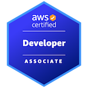
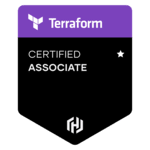
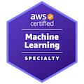
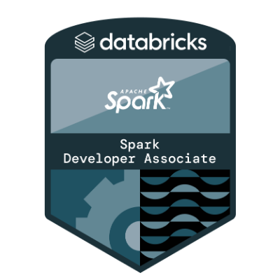
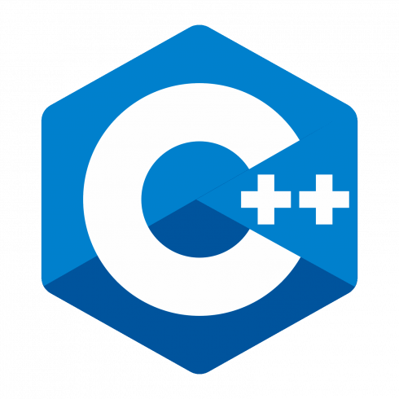
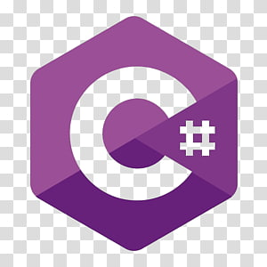
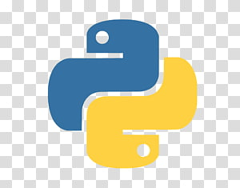

<h1> 
Ryan Rosiak
 </h1>
<h2> 
Senior Data Engineer @ KPMG
 </h2>
<h2> 
Leader - Developer - Mentor
 </h2>
<h2> 
Certifications
 </h2>

  </img>
  </img>
  </img>
  </img>

<h2> 
Language Proficiency
 </h2>

  </img>
  </img>
  </img>
  </img>
  </img>
  </img>
  </img>

<h2> 
Industry Skills
 </h2>
<h3> 
Advanced/Proficient Industry Knowledge
 </h3>
<ul>
  <li>
Python, Scala, and Apache Spark
</li>
  <li>
AWS (EMR, ECS, Glue, S3, SageMaker, EC2, EKS, EFS, Lambda, IAM, etc.) and public/private cloud technologies
</li>
  <li>
Azure/AWS-hosted Databricks (Delta Tables, Apache Iceberg/Arrow, Lakeflow, etc.)
</li>
  <li>
Agentic systems design and implementation (RAG, long context, MCP)
</li>
  <li>
Prompt engineering (LLMs), Copilot, Windsurf, and Claude Code
</li>
  <li>
Terraform, shell scripting (UNIX/Linux, Bash/CLI), and RESTful APIs
</li>
  <li>
Containerization, Docker, and Kubernetes
</li>
  <li>
Database design and management (PostgreSQL, MySQL, Spark SQL, NoSQL, and Microsoft SQL Server/LINQ)
</li>
  <li>
TypeScript and web development (React, Tailwind, FastAPI, Playwright, React Native, HTML, CSS, JavaScript, Spring Core/Boot/MVC, Maven, and Flask)
</li>
</ul>
<h3> 
General Working Industry Knowledge
 </h3>
<ul>
  <li>
C, C++, Go, Java, C#, and PHP
</li>
</ul>
<h3> 
Other Industry Proficient Technologies
 </h3>
<ul>
  <li>
Cloud DevOps/networking and Git
</li>
  <li>
Workflow and collaboration tools (Confluence, Jira, Bitbucket, GitHub, and Cloud Foundry applications)
</li>
  <li>
Enterprise application development
</li>
  <li>
Big data: Hadoop, Hive, and YARN
</li>
  <li>
Machine learning and data science: time-series forecasting, regression and classification, NLTK, NumPy, Matplotlib, Pandas, Seaborn, and Jupyter Notebooks
</li>
  <li>
Parallel processing: Open MPI and MPICH
</li>
  <li>
Cybersecurity tools: Nmap, Burp Suite, and Metasploit
</li>
  <li>
Markup and configuration languages: XAML, XML, and YAML
</li>
</ul>
<h2> 
About Me
 </h2>

I’m a Senior Data Engineer at KPMG specializing in large-scale data engineering, distributed computing, and cloud platforms. I design scalable, reliable data solutions with technologies such as Apache Spark, and bring experience in software engineering, big data, and machine learning. I’ve led engineering initiatives, contributed to architecture, and mentored engineers, with a focus on turning emerging technologies into practical business solutions. I hold degrees in Computer Science and Data Science from Salisbury University. Outside work, I enjoy exploring data and AI technologies and spending time with family and friends. View my projects on my <a href="http://spa542.pythonanywhere.com/index.html">portfolio</a>.

